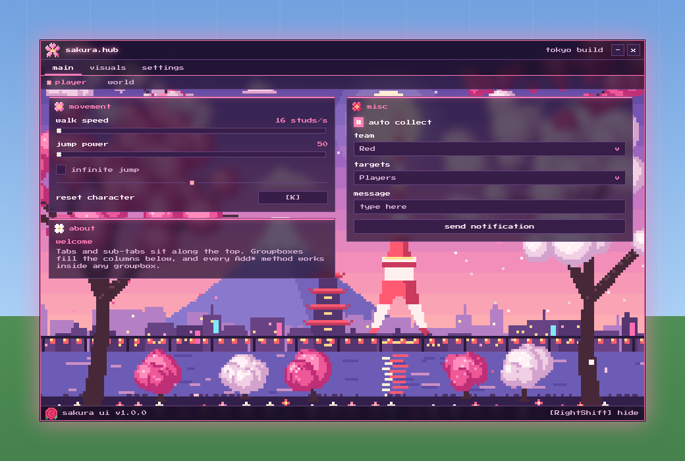

# Sakura UI

A wide, Linoria-style Roblox UI library for script executors, with a pixel-art Tokyo look.



- Tabs **and sub-tabs along the top**, groupboxes in 1–4 columns underneath
- Pixel font (`Enum.Font.Arcade`, Press Start 2P) everywhere, pixel-flower toggles, slider handles and icons
- Pixel-art backdrop drawn from frames: Mount Fuji, Tokyo Tower, a pagoda, the skyline, a river, rose and white blossom trees, and falling petals
- **Adjustable glow** made with `UIShadow` (size, spread, strength, colour, pulse)
- **Frosted panels** made with `UIBlur` (Off / Light / Medium / Heavy, plus panel opacity)
- Three themes: Dusk, Night, Day, plus a custom accent colour
- Everything from Nova UI: toggles, sliders, dropdowns, textboxes, keybinds, colour pickers, notifications, configs, unload

If the client cannot create `UIShadow` or `UIBlur` yet, the library detects that and falls back (an image glow, a plain tinted panel), so it never errors.

## Loading

```lua
local Sakura = loadstring(game:HttpGet("https://raw.githubusercontent.com/282882yea/e/claude/executor-ui-tabs-pixeled-aww4ux/Sakura.lua"))()
```

Or paste [`sakura-standalone.lua`](sakura-standalone.lua) (library + demo in one file). The full demo is [`sakura-example.lua`](sakura-example.lua).

## Quick start

```lua
local Window = Sakura:CreateWindow({
	Title = "sakura.hub",
	SubTitle = "tokyo build",          -- optional
	Size = UDim2.fromOffset(920, 580),  -- optional, wide by default
	Theme = "Dusk",                     -- Dusk, Night, Day
	Columns = 2,                        -- default columns per sub-tab
	PixelSize = 4,                      -- on-screen size of one backdrop pixel
	ToggleKey = Enum.KeyCode.RightShift,
	ConfigFolder = "SakuraHub",
})

local Main = Window:AddTab("main")            -- top row
local Player = Main:AddSubTab("player")       -- second row
local Box = Player:AddLeftGroupbox("movement")

Box:AddToggle({ Name = "fly", Flag = "Fly", Callback = function(on) end })

local Esp = Window:AddTab("visuals"):AddSubTab({ Name = "esp", Columns = 3 })
Esp:AddGroupbox("boxes", 1)
Esp:AddGroupbox("names", 2)
Esp:AddGroupbox("chams", 3)

Window:AddSettingsTab() -- theme, accent, glow, glass, petals, configs, toggle key, unload
```

`Tab:AddLeftGroupbox` / `AddRightGroupbox` also work straight on a tab; they go into a "general" sub-tab.

## Elements

Every groupbox has the same methods as Nova UI (see [README.md](README.md)): `AddButton`, `AddToggle`, `AddSlider`, `AddDropdown`, `AddTextbox`, `AddKeybind`, `AddColorPicker`, `AddLabel`, `AddParagraph`, `AddDivider`. Each returns an object with `.Value`, `:Set(value, silent)` and `:OnChanged(fn)`; flags are in `Sakura.Flags` and `Sakura.Options`.

## Glow (UIShadow)

```lua
Sakura:SetGlow({
	Enabled = true,
	Size = 32,        -- blur radius in px
	Spread = 2,       -- px
	Strength = 0.7,   -- 0..1
	Pulse = true,     -- gentle breathing
	Elements = true,  -- small glow on toggles, sliders, tabs, title text
	Color = Color3.fromRGB(255, 120, 180), -- false = follow the accent
})
```

## Glass (UIBlur)

```lua
Sakura:SetGlass({ Blur = "Medium", Transparency = 0.28 }) -- Off, Light, Medium, Heavy
```

`Sakura.Support.UIShadow` / `Sakura.Support.UIBlur` tell you what the client supports.

## Look

```lua
Sakura:SetTheme("Night")                         -- Dusk, Night, Day, or a table
Sakura:SetAccent(Color3.fromRGB(120, 200, 255))  -- nil = theme's own
Sakura:SetPetals({ Enabled = true, Count = 16, Speed = 1 })
Sakura:SetWatermark("sakura.hub | v1.0")         -- false hides it
Window:SetBackground(false)                      -- hide the pixel backdrop
```

Theme keys: `Scene` (`"Dusk"`, `"Night"`, `"Day"`), `Outline`, `Accent`, `Panel`, `Header`, `Element`, `ElementHover`, `Stroke`, `Text`, `SubText`, `Knob`.

## Window, configs, teardown

```lua
Window:Toggle()  Window:SetVisible(false)  Window:SetMinimized(true)
Window:SetToggleKey("F4")  Window:SelectTab(tab)  tab:SelectSubTab(sub)

Sakura:SaveConfig("default", "SakuraHub")
Sakura:LoadConfig("default", "SakuraHub")
Sakura:Notify({ Title = "hi", Content = "text", Duration = 4 })
Sakura.OnUnload = function() end
Sakura:Unload()
```

## Editing the backdrop

The scene is generated by [`tools/scene.js`](tools/scene.js) and baked into `Sakura.lua` as compact rectangle data. After changing it:

```sh
node tools/build.js   # rewrites the scene block in Sakura.lua and sakura-standalone.lua
```
