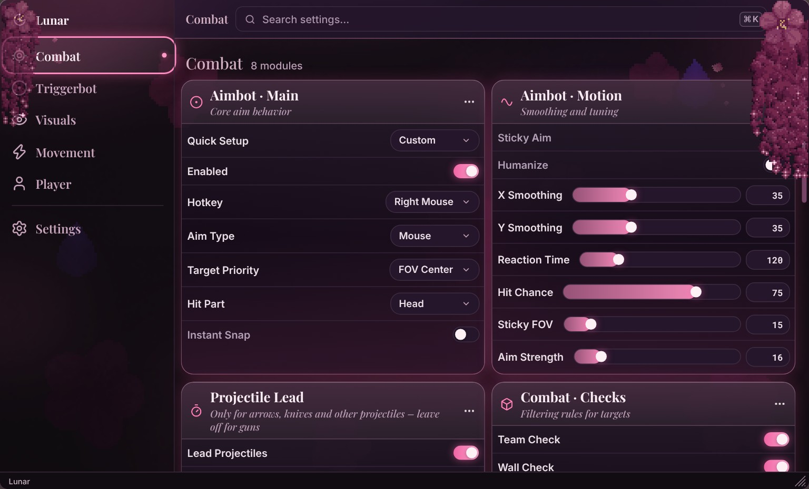

# Lunar UI

A single-file Roblox UI library for script executors, built to match the Lunar reference design: plum glass window, pixel-art flower cascades, serif navigation, two-column module cards.



*Layout preview rendered by the test harness described at the bottom, not a capture from a Roblox client.*

- Backdrop blur with `UIBlur`, falling back to the glass-part trick on clients without it
- Every glow is a `UIShadow` (9-slice image fallback on older clients)
- Flowers, backdrop and icons are images, embedded in the script and written to the executor workspace on first run — nothing is downloaded
- Animated: intro, tab glide, page slide/fade, toggle spring, slider, popups, card collapse, falling petals, twinkling blossoms, breathing glows
- Toggle, slider, dropdown (single/multi), keybind, button, textbox, label
- Search (`Ctrl+K`), drag, resize, auto-fit to small screens, notifications

## Files

| File | Use |
| --- | --- |
| `standalone.lua` | Library + demo in one file. Paste it into the executor to see the reference layout. |
| `Lunar.lua` | The library on its own, for `loadstring`. |
| `example.lua` | The demo script that builds the reference layout. |
| `src/Lunar.lua` | Library source, without the embedded images. Edit this one. |
| `assets/` | The images, plus the icon/art metadata the build reads. |
| `tools/` | `build.py` (embeds the images), `gen_art.py` (flowers and backdrop), `gen_icons.mjs` (icon sheet). |

## Loading

```lua
local Lunar = loadstring(game:HttpGet("https://raw.githubusercontent.com/282882yea/e/ccr-85b7debf-yjg52n/lunar/Lunar.lua"))()
```

## Quick start

```lua
local Window = Lunar:CreateWindow({ Title = "Lunar" })

local Combat = Window:AddTab({ Name = "Combat", Icon = "locate-fixed" })

local Main = Combat:AddModule({
	Title = "Aimbot · Main",
	Description = "Core aim behavior",
	Icon = "circle-dot",
})

Main:AddToggle({ Name = "Enabled", Default = true, Flag = "Enabled", Callback = function(on) end })
Main:AddSlider({ Name = "Hit Chance", Min = 0, Max = 100, Default = 75, Flag = "HitChance" })
Main:AddDropdown({ Name = "Hit Part", Options = { "Head", "Torso" }, Default = "Head" })
Main:AddKeybind({ Name = "Hotkey", Default = Enum.UserInputType.MouseButton2 })

Window:AddDivider() -- the thin rule above "Settings" in the sidebar
local Settings = Window:AddTab({ Name = "Settings", Icon = "settings" })
```

Modules fill a two-column grid in the order they are added; both cards in a row share the taller one's height.

## Window options

| Option | Default | |
| --- | --- | --- |
| `Title` | `"Lunar"` | Sidebar title and status bar text |
| `Size` | `Vector2.new(1024, 620)` | Design size; the reference screenshot is this at 150% |
| `Scale` | `1` | `1.5` reproduces the screenshot's on-screen size. Shrinks automatically to fit the viewport |
| `ToggleKey` | `Enum.KeyCode.RightShift` | Hides/shows the window. `false` to disable |
| `Blur` | `"Auto"` | `"Auto"` (UIBlur, else glass), `"UIBlur"`, `"Glass"`, `"Both"`, `false` |
| `BlurStrength` | `"Medium"` | `"Light"`, `"Medium"`, `"Heavy"` (UIBlur only) |
| `Transparency` | `0.12` | How much of the blurred scene shows through, 0–0.6 |
| `CornerRadius` | `10` | Window corners. `0` for the square corners of the reference |
| `Petals` / `Twinkle` | `true` | Falling petals / twinkling blossoms |
| `Intro` | `true` | Fade-and-settle on first show |
| `Assets` | — | Replace images, see below |
| `Fonts` | — | `{ Serif = id, Sans = id, Mono = id }` font family overrides |
| `Folder` | `"Lunar"` | Workspace folder the images are written to |

```lua
Window:SetVisible(false)   Window:Toggle()
Window:SetScale(1.25)      Window:SelectTab(Settings)
Window:SetStatus("ready")  Window:Destroy()
Window.Blur                -- { Kind, Instance (the UIBlur, if any), SetEnabled }
```

## Controls

Every control takes `Name`, optional `Flag` and `Callback`, and returns an object.

| Method | Options | Value |
| --- | --- | --- |
| `AddToggle` | `Default` | `boolean` |
| `AddSlider` | `Min`, `Max`, `Step`, `Default`, `Suffix` | `number` (the value box is editable) |
| `AddDropdown` | `Options`, `Default`, `Multi` | the option, or `{ [option] = true }` with `Multi` |
| `AddKeybind` | `Default`, `Pressed` | `Enum.KeyCode` / mouse `Enum.UserInputType`, `nil` when unbound |
| `AddButton` | `Text` | – |
| `AddTextbox` | `Default`, `Placeholder`, `Width` | `string` |
| `AddLabel` | – | – |

```lua
local toggle = Main:AddToggle({ Name = "Enabled", Flag = "Enabled" })

toggle.Value            toggle:Set(true)        toggle:Set(true, true) -- silent
toggle:OnChanged(fn)    toggle:SetVisible(false)

Lunar.Flags.Enabled             -- current value by flag
Lunar.Options.Enabled:Set(true) -- control object by flag
```

`Callback` on a keybind fires when it is rebound, `Pressed` when the bound key is pressed. While rebinding, `Escape` cancels and `Backspace` clears.

Each card's `...` menu collapses the module or resets its controls to their defaults (`Module:SetCollapsed(true)`, `Module:Reset()`).

```lua
Lunar:Notify({ Title = "Lunar", Content = "Loaded.", Duration = 4 })
Lunar.OnUnload = function() end -- stop your own loops here
Lunar:Unload()
```

## Icons

`Icon` takes a name from the embedded sheet or any `rbxassetid://` image:

`moon` `locate-fixed` `circle-dot` `eye` `zap` `user` `settings` `search` `chevron-down` `ellipsis` `timer` `box` `command` `check` `x` `wave` `grip` `crosshair` `target` `shield` `sliders-horizontal` `palette` `keyboard` `sparkles` `rotate-ccw` `chevrons-up-down` `minus` `plus` `activity` `info` `bell` `save` `folder` `trash-2` `gauge` `move` `wind` `layers` `globe` `lock` `mouse-pointer-click` `scan` `radar` `flower-2` `star` `heart` `power` `chevron-right`

Icons are from [Lucide](https://lucide.dev) (ISC licence).

## Replacing the images

The window uses seven images: `background`, `blossoms` (dim oversized flowers behind the cards), `flowers_left`, `flowers_right`, `petal`, `icons`, `glow`. Each can be swapped for an asset id, a URL (downloaded once into the workspace) or a file already in the workspace; `false` removes it.

```lua
Lunar:CreateWindow({
	Assets = {
		background = "rbxassetid://1234567890",
		flowers_right = "https://example.com/my-flowers.png",
		blossoms = false,
	},
})
```

To change the embedded art instead, edit or replace the PNGs in `assets/` (or re-roll them with `python3 tools/gen_art.py`) and run `python3 tools/build.py`. The flower images are pixel art drawn at 2 design px per art pixel and shown with pixelated resampling.

## Compatibility

| Feature | Needs | Without it |
| --- | --- | --- |
| Images | `writefile` + `getcustomasset` | No flowers/backdrop/icons unless `Assets` supplies asset ids |
| Glow | `UIShadow` | 9-slice image halo |
| Blur | `UIBlur` | Glass part + `DepthOfFieldEffect` (needs graphics quality 8+) |
| Rounded window | per-corner `UICorner` radii | Square window corners |

`UIBlur` is new and may not be switched on for every client yet. If the window is not frosted on yours, pass `Blur = "Glass"` (or `"Both"`).

Fonts are Playfair Display and Inter from the Creator Store font catalogue and Roboto Mono from the engine, so they load without any files.

## How this was checked

The script was run end to end against a mock of the Roblox API generated from the current API dump (every class, property and enum is validated), with a layout pass rendered in a browser and compared against the reference screenshot, and with the interactions driven by a test script. It has not been run inside a live Roblox client from here, so engine-side behaviour of the newest instances (`UIBlur`, `UIShadow`) is the part to look at first if something is off.
